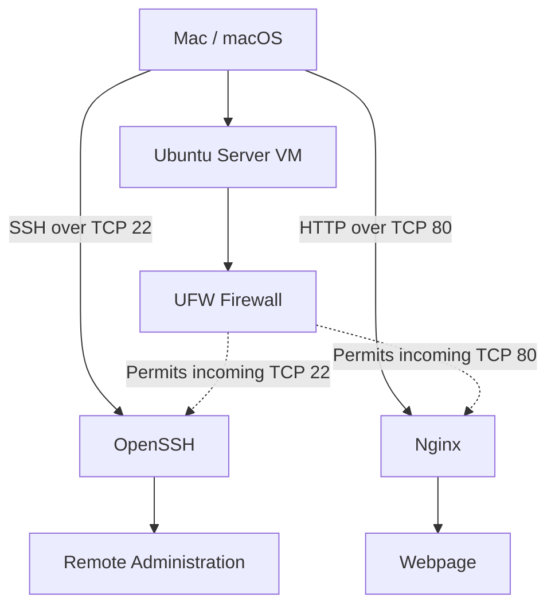

# Homelab Architecture

## Overview

My homelab runs Ubuntu Server in a virtual machine on my Mac. I use macOS Terminal to administer the server remotely over SSH.

The Ubuntu server runs Nginx to serve a webpage over HTTP. UFW controls which incoming connections are permitted.

## Architecture Diagram



## Components

- **Mac:** Provides physical computing resources and runs the virtualization software.
- **Ubuntu Server:** Guest operating system used for server administration.
- **OpenSSH:** Provides encrypted remote terminal access.
- **UFW:** Applies firewall rules to incoming network traffic.
- **Nginx:** Serves the HTTP webpage on TCP port 80.

## Verification

I verified the server using:

```bash
hostname
sudo ufw status verbose
sudo ss -tlnp
sudo nginx -t
systemctl is-active nginx
curl -I http://localhost
```

The HTTP test returned `200 OK`.
